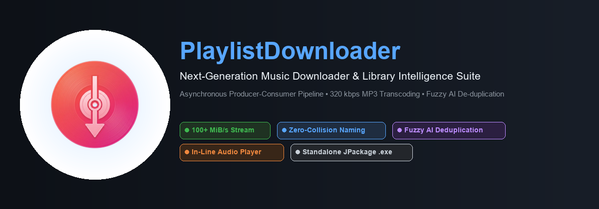
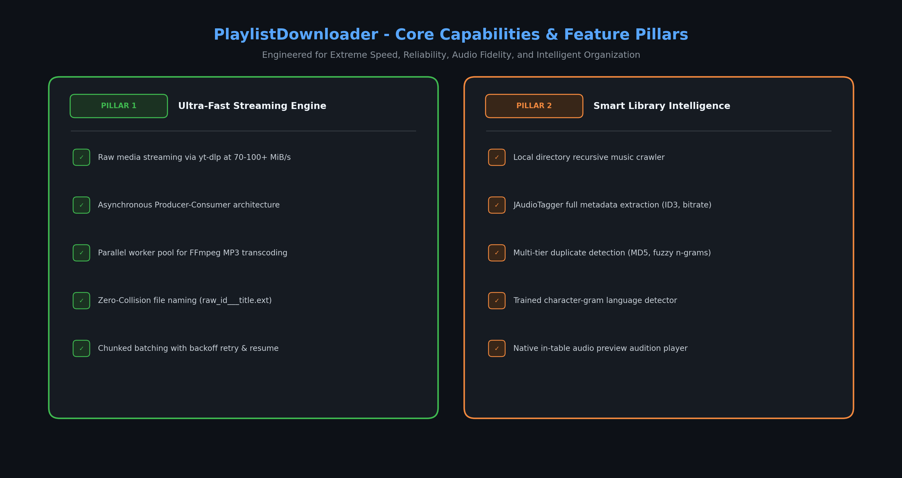
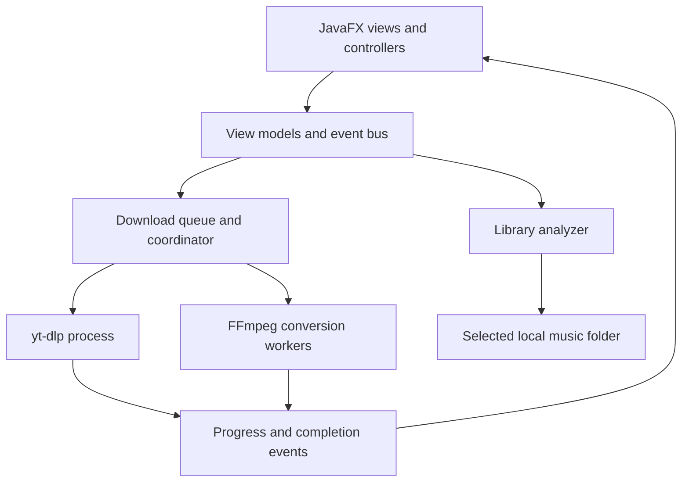
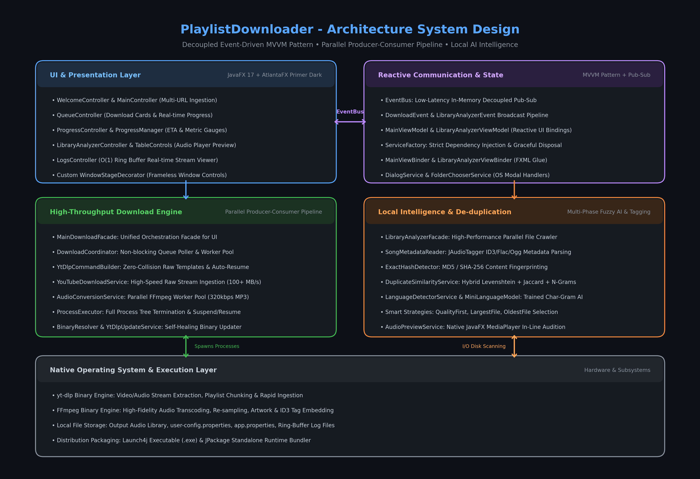

<p align="center">
  
</p>

<p align="center">
  
</p>

<h1 align="center">PlaylistDownloader</h1>

<p align="center">
  A JavaFX desktop application for downloading YouTube playlists, converting audio, and organizing a local music library.
</p>

<p align="center">
  <a href="https://openjdk.org/"></a>
  <a href="https://openjfx.io/"></a>
  <a href="LICENSE"></a>
</p>

> Use this application only for content you are authorized to access and download. You are responsible for complying with applicable laws and the terms of the source platform.

## Contents

- [Overview](#overview)
- [Features](#features)
- [Architecture](#architecture)
- [Requirements](#requirements)
- [Run from source](#run-from-source)
- [Build, test, and package](#build-test-and-package)
- [Configuration and data](#configuration-and-data)
- [Project layout](#project-layout)
- [License and acknowledgements](#license-and-acknowledgements)

## Overview

PlaylistDownloader combines a download queue, background audio conversion, and a local-library analyzer in one desktop application. Its interface is built with JavaFX and AtlantaFX. The application coordinates external `yt-dlp` and FFmpeg processes while keeping download and conversion work separate.

The library analyzer helps find likely duplicate tracks using file hashes, normalized titles, metadata, duration, and text-similarity signals. Users can preview candidates before deciding what to keep or move to quarantine.

## Features

- Add one or multiple YouTube video or playlist URLs to a processing queue.
- Download and audio conversion run asynchronously with bounded worker concurrency.
- Retain intermediate download files on failures so eligible work can be resumed without starting every transfer from scratch.
- Write unique intermediate filenames to reduce collisions between tracks with similar titles.
- Analyze a selected music folder for likely duplicates using hashes, title normalization, Levenshtein/Jaccard similarity, duration, and audio metadata.
- Browse language classifications and preview audio directly from the library analyzer.
- Language classification uses the Lingua library; the separately trained character n-gram model is not distributed.
- Review duplicate groups and move selected files to a quarantine folder rather than silently deleting them.
- Inspect application and process logs from the UI.

<p align="center">
  
</p>

## Architecture

The application uses a JavaFX presentation layer with controllers and view models, an in-memory event bus, and service/facade boundaries for downloads, conversion, library analysis, and updates.



<p align="center">
  
</p>

## Requirements

- Java Development Kit 17 or newer to build and run from source.
- `yt-dlp` and FFmpeg installed separately and available through the configured executable paths or `PATH`.
- Internet access for downloads and binary update checks.

The Windows installer script creates a Windows package with a bundled Java runtime. It does not bundle `yt-dlp` or FFmpeg; install those tools separately before downloading or converting audio. The documented installer target is Windows. Other JavaFX-supported environments may require platform-specific setup.

## Run from source

The Maven Wrapper downloads and uses the project’s configured Maven version.

```powershell
# Windows
.\mvnw.cmd clean javafx:run
```

```bash
# Linux or macOS
./mvnw clean javafx:run
```

Install `yt-dlp` and FFmpeg using their official project instructions. If they are not discoverable on `PATH`, configure their executable locations in the application settings.

The current user interface text is primarily Spanish.

## Build, test, and package

Run the deterministic test suite:

```powershell
.\mvnw.cmd clean verify
```

Build the executable JAR and the lightweight Windows launcher:

```powershell
.\mvnw.cmd clean package
```

Create the Windows installer (requires a Windows JDK with `jpackage` available):

```powershell
.\create_installer.ps1
```

Build output is written under `target/`. The installer includes a Java runtime but still requires separate installation/configuration of `yt-dlp` and FFmpeg.

## Configuration and data

- `src/main/resources/app.properties` contains application defaults.
- `user-config.properties` stores user-specific preferences and is intentionally excluded from Git.
- Downloaded audio and logs are local runtime data; keep them outside source control.
- `YT_DLP_PATH` and `FFMPEG_PATH` can be used when the executable locations are not available through `PATH`.

Do not commit local settings, downloaded media, logs, generated model-training corpora, or application build output.

## Project layout

```text
.
├── docs/                       # Product diagrams and documentation images
├── src/main/java/              # Application, UI, download, and analysis code
├── src/main/resources/         # JavaFX views, styles, icons, and application defaults
├── src/test/java/              # JUnit tests
├── tools/language-model/       # Development-only language-model training tools
├── create_installer.ps1        # Windows jpackage helper
├── pom.xml                     # Maven project and dependencies
└── README.md
```

## License and acknowledgements

The application source code is licensed under the [MIT License](LICENSE). Third-party dependencies and model/data assets may have separate terms; their upstream licenses remain applicable.

PlaylistDownloader builds on projects including [yt-dlp](https://github.com/yt-dlp/yt-dlp), [FFmpeg](https://ffmpeg.org/), [OpenJFX](https://openjfx.io/), [AtlantaFX](https://mkpaz.github.io/atlantafx/), [Ikonli](https://kordamp.org/ikonli/), and [JAudioTagger](https://www.jthink.net/jaudiotagger/). Please consult each project for its license and usage requirements.
